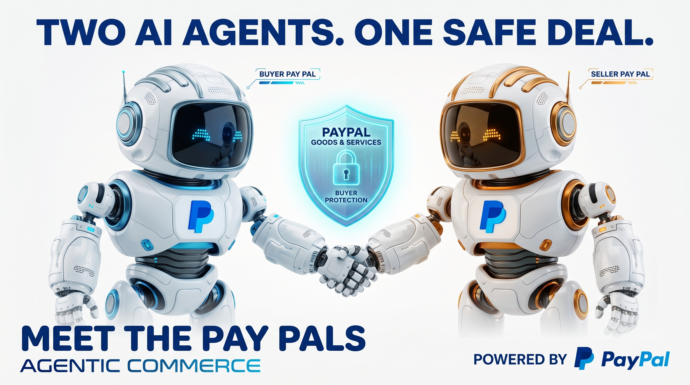

# Pay Pals

**Two AI agents. One safe deal.**

Pay Pals puts an AI agent on each side of a stranger deal. The buyer's pal vets the listing, the seller's pal locks the item into a PayPal Goods & Services payment, and both keep proof.

Built for the PayPal AI Hackathon. Runs on the PayPal sandbox.



## How it works
- **Seller Pal** (gold) turns a listing and photos into an item card: model, serial read from the photos, condition, what is included, price.
- **Buyer Pal** (blue) checks the price against market data (Channel3), reads the chat for scam patterns, asks for what is missing, and gives a plain verdict. Payment-method flags (Friends and Family, off-platform) end the deal; the buyer cannot override them.
- When both sides agree, the card is locked and becomes a PayPal Goods and Services checkout order paid to the seller, with the item details on the order.
- After delivery the Buyer Pal checks what arrived against the locked card. If something is wrong, an evidence pack is built for a PayPal dispute.

Three demo scenarios ship in the app: a scam that gets stopped, a clean deal that completes, and a wrong item that arrives.

## Run it

Needs Node 22 and npm 10.

```bash
git clone <this repo>
cd pay-pals
npm install
npm run dev -w apps/web      # http://localhost:3000
```

No keys are needed for demo mode. The three scenarios run on fixtures, the pals run their deterministic rules, and the pay step shows labelled demo buttons.

For the real thing, copy `.env.example` to `.env.local` and fill in:

| Key | Gives you |
|---|---|
| `PAYPAL_CLIENT_ID`, `PAYPAL_CLIENT_SECRET`, `NEXT_PUBLIC_PAYPAL_CLIENT_ID` | Real PayPal sandbox orders and the PayPal and Venmo buttons. Sandbox only; the code refuses anything else. |
| `PAYPAL_WEBHOOK_ID` | Webhook signature verification. |
| `ANTHROPIC_API_KEY` | Claude for both pals. Without it the pals run rules only. |
| `CHANNEL3_API_KEY` | Live market prices. Without it the fixture price ranges are used. |
| `DATABASE_URL` | Postgres (Neon) instead of the in-memory store. |

Hosted demo: https://pay-pals-m00n1.vercel.app (PayPal sandbox, Neon, live Claude and Channel3). In development for the PayPal AI Hackathon.

## Test it

```bash
SKIP_REAL_TESTS=1 npm test   # every workspace, no network
npm test                     # also runs the sandbox PayPal and Claude tests when keys are present
npm run build
npm run gate -w packages/paypal   # Lane 0: proves a sandbox personal and business payee both get paid
```

## Layout

```
packages/contracts   types, deal state table, interfaces, demo fixtures
packages/agents      Seller Pal, Buyer Pal, red-flag rules, Channel3 client, evidence pack
packages/paypal      PayPal sandbox gateway, webhook handler, Lane 0 gate
packages/db          in-memory and Postgres deal stores, migrations
apps/web             the Next.js app a judge clicks through
tests/               integration and end-to-end suites
coordination/        how this repo was built: plan, working agreement, worklog
docs/adr/            decisions
docs/postman/        the PayPal calls as a Postman collection
```

## License
MIT. See `LICENSE`.
